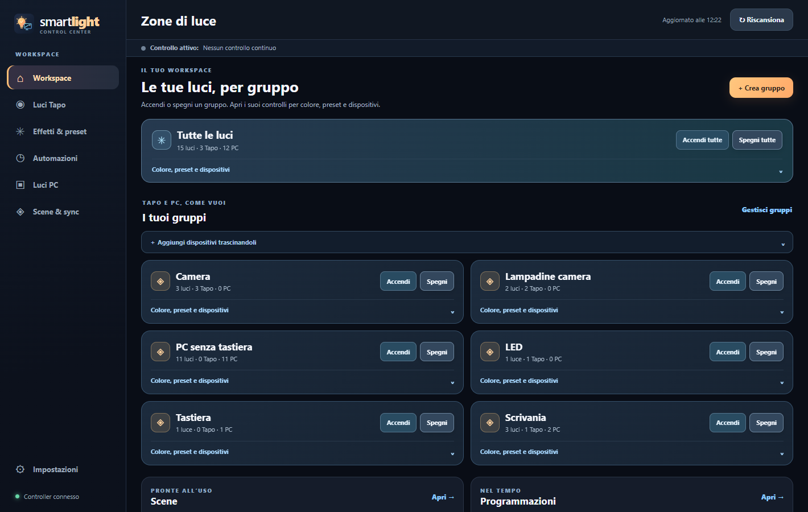

# Smartlight — Luci Tapo e RGB del PC, insieme

**La tua stanza, il tuo PC, un solo posto per controllare le luci.**

[English](README.md) · [Download](https://github.com/nemmusu/smartlight/releases/latest) · [Primo avvio](FIRST_RUN.md) · [Linux](LINUX.md) · [Compatibilità](docs/COMPATIBILITY.md)

Smartlight riunisce luci TP-Link Tapo e illuminazione RGB del PC in un’app per Windows e Linux. Stanze, colori, effetti, preset e programmazioni sono accessibili dalla stessa interfaccia. L’interfaccia parte in **inglese**. Puoi passare in qualsiasi momento a **Italiano o English** da **Impostazioni → Generali → Lingua**; la scelta viene salvata.

## Cosa puoi fare

- Controllare una luce, più dispositivi, una stanza o tutte le luci.
- Regolare colore, bianco e luminosità secondo le capacità del dispositivo.
- Salvare preset e scene e scegliere velocità e intervallo di luminosità delle animazioni.
- Usare effetti nativi Tapo dove disponibili e animazioni condivise con il PC.
- Programmare azioni scegliendo calendario, giorni e orari; impostare timer e presenza simulata.
- Usare gli stessi controlli da interfaccia, menu vicino all’orologio e assistenti AI tramite MCP.
- Esportare la configurazione senza includere le credenziali Tapo.

## Con cosa funziona

| Sistema | Luci Tapo | RGB PC |
| --- | --- | --- |
| Windows | Rete locale | OpenRGB e iCUE secondo hardware e software rilevati |
| Linux | Rete locale | OpenRGB, anche per Corsair; iCUE non viene usato |

Le famiglie Tapo L530 e L900 sono state provate. Per gli altri dispositivi valgono capacità, firmware e supporto delle integrazioni. Il catalogo OpenRGB è consultabile nella guida: non significa che ogni modello sia stato provato individualmente con Smartlight.

**MSI Mystic Light è sperimentale:** solo Windows, alternativa automatica quando le integrazioni principali non trovano luci PC, verifiche simulate e nessuna prova fisica su hardware MSI. [Dettagli](docs/MYSTIC_LIGHT.md).

## Parti da qui

1. Installa Smartlight seguendo la [guida al primo avvio](FIRST_RUN.md).
2. Per le luci PC lascia **Automatico**: Smartlight rileva hardware e software disponibili e indica eventuali componenti mancanti con il collegamento ufficiale.
3. Aggiungi l’account Tapo nelle impostazioni e cerca le luci sulla rete locale.
4. Crea le stanze e scegli colori, preset o effetti.

Scarica l’ultima versione da [GitHub Releases](https://github.com/nemmusu/smartlight/releases/latest): **Windows** `Smartlight-Setup-0.4.1.exe` oppure **Linux** `Smartlight_0.4.1_amd64.deb`. Per i requisiti Linux consulta [LINUX.md](LINUX.md).

## Configurazione delle luci PC

Lascia **Automatico**: Smartlight rileva hardware e software disponibili e indica eventuali componenti mancanti con il collegamento ufficiale. Su Windows puoi anche scegliere **OpenRGB**, **iCUE** oppure **MSI Mystic Light**; su Linux **OpenRGB**. Dopo una modifica usa **Applica e riavvia**.

“Pronto” significa che sono state rilevate luci realmente controllabili. L’integrazione MSI sperimentale può recuperare e verificare automaticamente l’SDK ufficiale quando sono presenti hardware e software richiesti: non devi selezionare DLL. Il software del produttore può richiedere la propria procedura guidata. [Configurazione e limiti MSI](docs/MYSTIC_LIGHT.md).

## Assistenti AI

In **Impostazioni → Assistenti MCP** trovi la configurazione da copiare nel client. Smartlight deve restare aperto, anche nell’area di notifica.

Puoi chiedere, per esempio: “Metti le luci della scrivania blu”, “Spegni le luci PC tranne la tastiera” oppure “Crea una programmazione per le sere feriali”. L’assistente deve prima leggere dispositivi e capacità disponibili.

Le schermate del repository usano dispositivi simulati. Per contribuire: [CONTRIBUTING.md](CONTRIBUTING.md). Per segnalazioni e dati riservati: [SECURITY.md](SECURITY.md).
