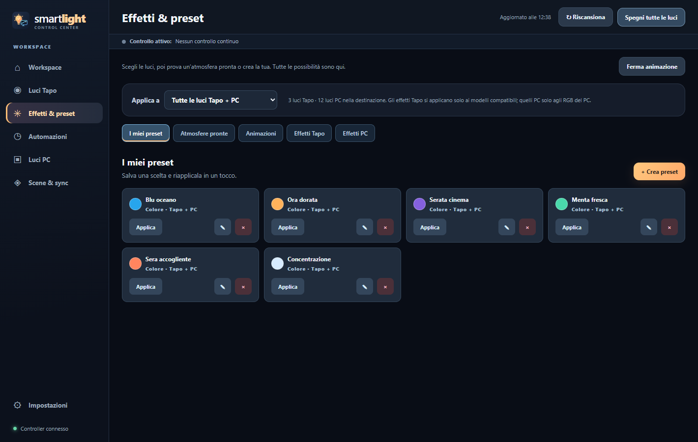
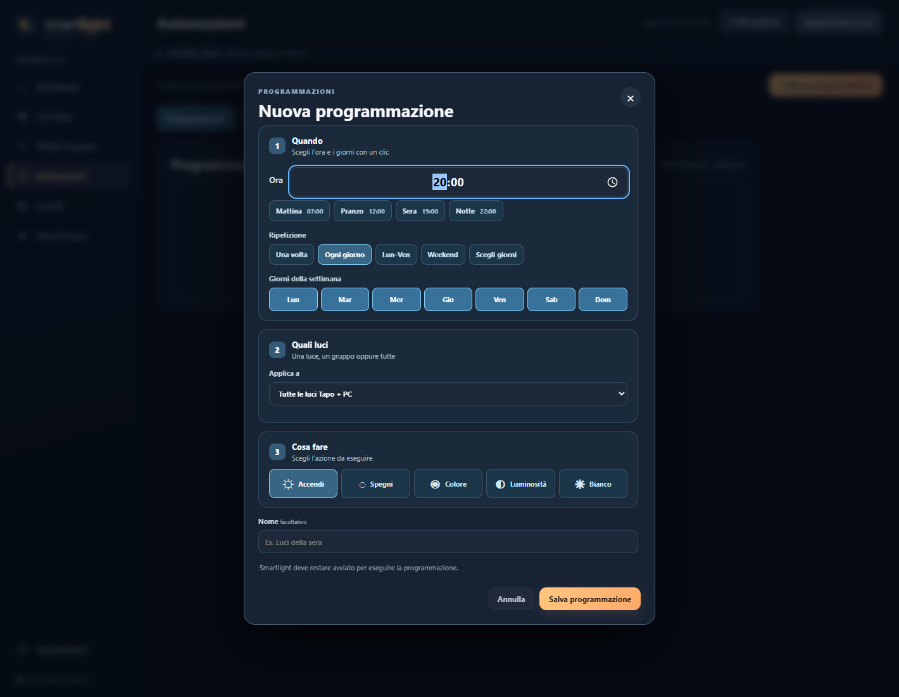
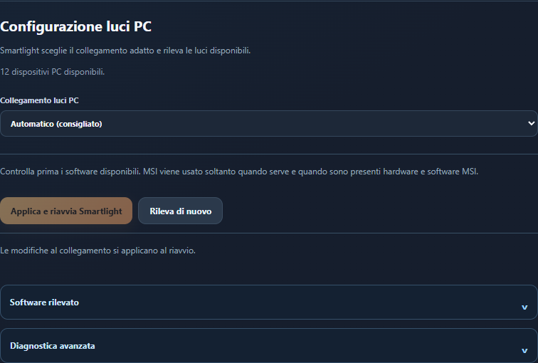

<h1 align="center">Smartlight</h1>

<b>La tua stanza, il tuo PC, un solo posto per tutte le luci.</b> 
Controlla insieme luci TP-Link Tapo e RGB del PC, con colori, effetti e programmazioni.

  

  
  
  
  
  

<a href="README.md">English</a> · Italiano · <a href="docs/COMPATIBILITY.md">Compatibilità</a>

## Le luci, come piacciono a te

<table>
  <tr>
    <td width="50%" valign="top">
      <h3>🎨 Trova la tua atmosfera</h3>
      Scegli un colore, salva un preset o avvia un effetto. Regola velocità e intervallo di luminosità delle animazioni, con effetti nativi Tapo sui modelli compatibili.
        
      
    </td>
    <td width="50%" valign="top">
      <h3>📅 Luci al ritmo della tua giornata</h3>
      Scegli giorni e orari nel calendario. Aggiungi timer o presenza simulata e ritrova tutte le tue routine nello stesso posto.
        
      
    </td>
  </tr>
  <tr>
    <td width="50%" valign="top">
      <h3>💡 Una luce o tutta la stanza</h3>
      Raggruppa luci Tapo e PC. Controlla un dispositivo, una selezione, una stanza o tutto insieme, con la destinazione visibile prima di applicare una modifica.
        
      
    </td>
    <td width="50%" valign="top">
      <h3>⚙️ Qualche impostazione in meno</h3>
      La modalità automatica rileva le integrazioni disponibili per le luci PC e mostra cosa manca. Puoi scegliere tu un'integrazione quando preferisci.
        
      
    </td>
  </tr>
</table>

Trovi anche: comandi nell'area di notifica per luci PC e Tapo, scene salvate, backup della configurazione senza credenziali Tapo e un controller condiviso tra app e assistenti AI. Lo stato Tapo si aggiorna periodicamente per rilevare le modifiche fatte fuori da Smartlight.

*Le schermate usano dispositivi simulati e preset dimostrativi inventati.*

## Download

Scegli il pacchetto, oppure consulta la **[versione più recente](https://github.com/nemmusu/smartlight/releases/latest)**:

| Sistema | Download |
| --- | --- |
| Windows | [Scarica il programma di installazione Windows (.exe)](https://github.com/nemmusu/smartlight/releases/download/v0.4.2/Smartlight-Setup-0.4.2.exe) |
| Linux, pacchetto Debian | [Scarica il pacchetto Linux (.deb)](https://github.com/nemmusu/smartlight/releases/download/v0.4.2/Smartlight_0.4.2_amd64.deb) |

Il pacchetto Linux richiede Python 3.12 e GTK/WebKit. Consulta la [guida Linux](LINUX.md) per i requisiti e l'installazione dai sorgenti.

## Inizia in 3 passi

1. **Installa e apri Smartlight.** Lascia le luci PC su **Automatico** e segui gli eventuali suggerimenti di configurazione.
2. **Aggiungi le luci Tapo.** Inserisci il tuo account Tapo nelle impostazioni e cerca i dispositivi sulla rete locale.
3. **Scegli le tue luci.** Crea una stanza, poi applica un colore, un preset o un effetto.

L'app parte in **inglese**. Puoi cambiarlo in qualsiasi momento da **Impostazioni → Generali → Lingua**. Sono disponibili inglese e italiano e la scelta viene salvata.

## Con cosa funziona Smartlight?

| Integrazione | Windows | Linux | Cosa aspettarsi |
| --- | --- | --- | --- |
| TP-Link Tapo | Sì | Sì | Provato con dispositivi delle famiglie L530 e L900. Le funzioni dipendono da modello e firmware. |
| OpenRGB | Sì | Sì | Luci PC supportate dalla versione di OpenRGB installata. Su Linux gestisce anche Corsair. |
| Corsair iCUE | Sì | No | Luci Corsair compatibili tramite iCUE. La modalità automatica può usare OpenRGB se iCUE non trova dispositivi. |
| MSI Mystic Light | Sperimentale | No | Animazioni software ed effetti nativi rilevati, con controlli specifici per dispositivo. Non ancora verificato su hardware MSI fisico. |

La modalità automatica prova prima le integrazioni PC principali. MSI è un'alternativa quando queste non trovano luci PC e sono presenti hardware e software MSI richiesti. L'SDK ufficiale può quindi essere scaricato e verificato automaticamente. Puoi anche selezionare un'integrazione manualmente e usare **Applica e riavvia**.

Il catalogo OpenRGB descrive il supporto offerto da OpenRGB; non significa che ogni modello sia stato provato con Smartlight. Leggi la [guida alla compatibilità](docs/COMPATIBILITY.md) e i [dettagli su MSI sperimentale](docs/MYSTIC_LIGHT.md).

## Chiedilo al tuo assistente AI

Smartlight include un **server MCP**: un assistente compatibile può trovare le luci, riconoscere tipi di dispositivo come le tastiere, usare le stanze e gestire colori, effetti, preset e programmazioni.

> “Metti le luci della scrivania blu.”
>
> “Spegni le luci PC tranne la tastiera.”
>
> “Crea una programmazione per le sere feriali.”

Apri **Impostazioni → Assistenti MCP** e copia la configurazione nel tuo client. Tieni Smartlight aperto, anche nell'area di notifica. Chiedi all'assistente di controllare prima dispositivi e capacità disponibili. Sono supportate connessioni locali stdio e Streamable HTTP con autenticazione.

## Ti serve una mano?

- [Primo avvio](FIRST_RUN.md): installazione e configurazione iniziale.
- [Guida Linux](LINUX.md): requisiti e configurazione OpenRGB.
- [Compatibilità](docs/COMPATIBILITY.md): integrazioni supportate e relativi limiti.
- [Contribuire](CONTRIBUTING.md): sviluppo e test simulati.
- [Sicurezza](SECURITY.md): dati riservati e accesso alla rete.
