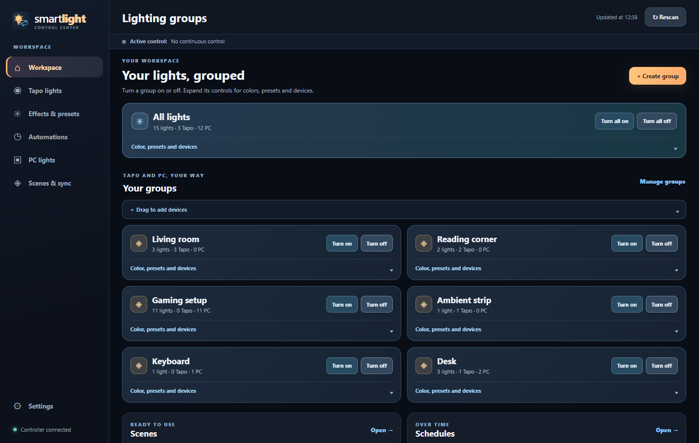
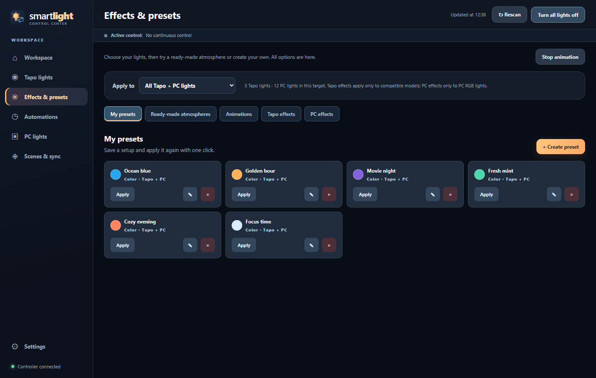
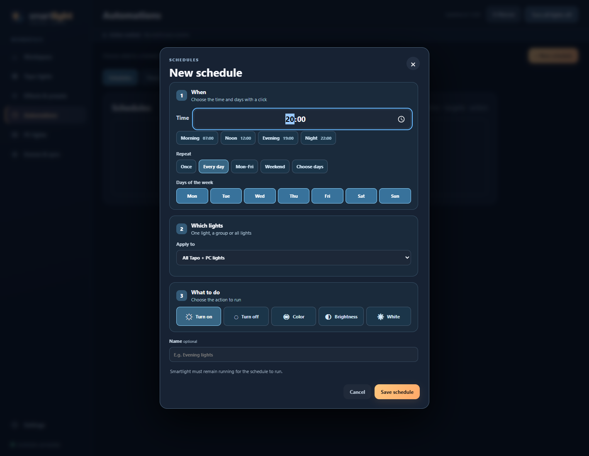
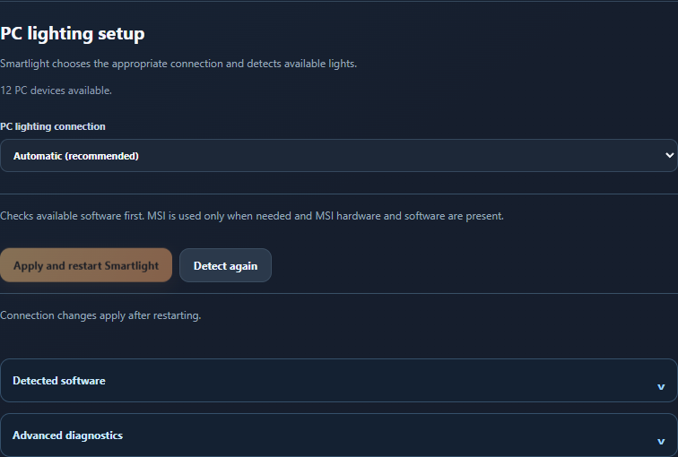

<h1 align="center">Smartlight</h1>

<b>Your room, your PC, one place for all your lights.</b> 
Control TP-Link Tapo lights and PC RGB together, with colors, effects and schedules.

  

  
  
  
  
  

English · <a href="README.it.md">Italiano</a> · <a href="docs/COMPATIBILITY.md">Compatibility</a>

## Make the lights yours

<table>
  <tr>
    <td width="50%" valign="top">
      <h3>🎨 Find your atmosphere</h3>
      Pick a color, save a preset or play an effect. Adjust animation speed and brightness range, with native Tapo effects on supported models.
        
      
    </td>
    <td width="50%" valign="top">
      <h3>📅 Let the lights follow your day</h3>
      Choose days and times in the calendar. Add timers or presence simulation, and keep your routines in one place.
        
      
    </td>
  </tr>
  <tr>
    <td width="50%" valign="top">
      <h3>💡 One light or the whole room</h3>
      Group Tapo and PC lights together. Control a device, a selection, a room or everything, with the target shown before you apply a change.
        
      
    </td>
    <td width="50%" valign="top">
      <h3>⚙️ A little less setup</h3>
      Automatic mode detects available PC lighting integrations and shows what is missing. You can choose an integration yourself whenever you prefer.
        
      
    </td>
  </tr>
</table>

Also included: tray controls for PC and Tapo lights, saved scenes, configuration backups without Tapo credentials, and a shared controller for the app and AI assistants. Tapo state refreshes periodically to pick up changes made outside Smartlight.

*Screenshots use simulated devices and invented demonstration presets.*

## Download

Choose your package, or browse the **[latest release](https://github.com/nemmusu/smartlight/releases/latest)**:

| System | Download |
| --- | --- |
| Windows | [Download the Windows installer (.exe)](https://github.com/nemmusu/smartlight/releases/download/v0.4.3/Smartlight-Setup-0.4.3.exe) |
| Linux, Debian package | [Download the Linux package (.deb)](https://github.com/nemmusu/smartlight/releases/download/v0.4.3/Smartlight_0.4.3_amd64.deb) |

The Linux package requires Python 3.12 and GTK/WebKit. See the [Linux setup guide](LINUX.md) for requirements and source installation.

## Get started in 3 steps

1. **Install and open Smartlight.** Leave PC lighting on **Automatic** and follow any setup suggestions.
2. **Add your Tapo lights.** Enter your Tapo account in Settings and discover devices on your local network.
3. **Choose your lights.** Create a room, then apply a color, preset or effect.

The app starts in **English**. Change it anytime in **Settings → General → Language**. English and Italian are included, and your choice is saved.

## What works with Smartlight?

| Integration | Windows | Linux | What to expect |
| --- | --- | --- | --- |
| TP-Link Tapo | Yes | Yes | Tested with L530 and L900 family devices. Features depend on model and firmware. |
| OpenRGB | Yes | Yes | PC lights supported by your installed OpenRGB version. On Linux, this also handles Corsair. |
| Corsair iCUE | Yes | No | Supported Corsair lights through iCUE. Automatic mode can use OpenRGB if iCUE finds no devices. |
| MSI Mystic Light | Experimental | No | Software animations and discovered native effects, with device-specific controls. No physical MSI hardware validation yet. |

Automatic mode tries the usual PC integrations first. MSI is a fallback when they find no PC lights and the required MSI hardware and software are present. Its official SDK can then be downloaded and verified automatically. You can also select an integration manually and use **Apply and restart**.

The OpenRGB catalog describes upstream support; it does not mean every model was tested with Smartlight. Read the [compatibility guide](docs/COMPATIBILITY.md) and [experimental MSI details](docs/MYSTIC_LIGHT.md).

## Ask your AI assistant

Smartlight includes an **MCP server**, so a compatible assistant can discover lights, identify device types such as keyboards, work with rooms, and manage colors, effects, presets and schedules.

> “Make the desk lights blue.”
>
> “Turn off PC lights except the keyboard.”
>
> “Create a weekday evening schedule.”

Open **Settings → MCP assistants** and copy the configuration into your client. Keep Smartlight running, including in the tray. Ask the assistant to check available devices and capabilities first. Local stdio and authenticated Streamable HTTP connections are supported.

## Need a hand?

- [Getting started](FIRST_RUN.md): installation and first setup.
- [Linux guide](LINUX.md): requirements and OpenRGB setup.
- [Compatibility](docs/COMPATIBILITY.md): supported integrations and their limits.
- [Contributing](CONTRIBUTING.md): development and simulated tests.
- [Security](SECURITY.md): sensitive data and network access.
